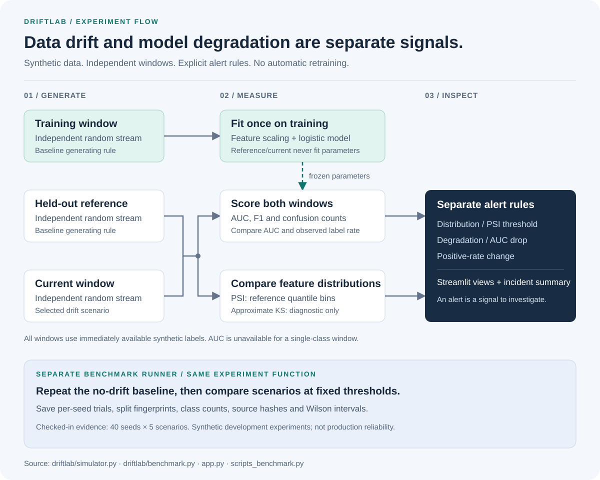
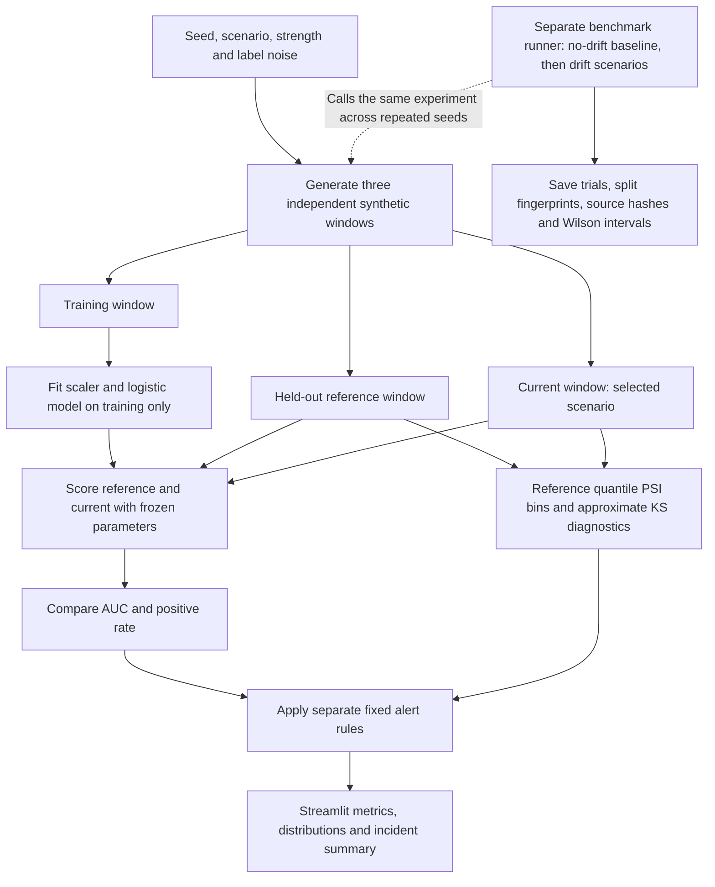

# DriftLab: Model Monitoring Simulator

**Explore how distribution changes affect a model.**

DriftLab is a Streamlit simulator for investigating model-monitoring alerts. Choose a synthetic drift scenario, score a frozen logistic model, and compare distribution changes with held-out predictive performance. The training, reference, and current windows are generated independently.

[Workflow and source-code map](WORKFLOW.md) · [Repeated evaluation report](outputs/MONITORING_BENCHMARK.md) · [Full benchmark evidence](outputs/monitoring_benchmark.json)

[Hosted Streamlit demo](https://yogesh-driftlab-monitoring.streamlit.app/) — the hosted app may lag this repository; the verification below covers local code and the Streamlit test harness.

## What you can explore

- No drift, mean shift, variance shift, changes in positive rate, and mixed feature/conditional-label changes.
- PSI and approximate two-sample KS diagnostics for four features.
- Accuracy, precision, recall, F1, ROC-AUC, confusion counts, and class rates.
- Separate distribution, AUC degradation, and positive-rate alerts.
- How sample size, label noise, drift strength, and fixed alert thresholds affect the result.

The app uses immediately available synthetic labels. It does not monitor production traffic or automatically retrain a model.

## How it works





The benchmark calls the same experiment function as the app. It runs separately from the UI. Changing a current-window scenario does not refit the model on that window. PSI drives the distribution alert; KS p-values are diagnostic only.

| Component | Responsibility |
|---|---|
| [`app.py`](app.py) | Streamlit controls, charts, metrics and alert display |
| [`driftlab/simulator.py`](driftlab/simulator.py) | Independent streams, train-only scaling, model fit, scoring and alert rules |
| [`driftlab/benchmark.py`](driftlab/benchmark.py) | Repeated seeds, paired scenarios and binomial uncertainty |
| [`scripts_benchmark.py`](scripts_benchmark.py) | CLI, saved JSON/report and source hashes |
| [`tests/`](tests/) | Independence, numerical edge cases, alert behavior and app smoke checks |

## Why the reference baseline changed

The earlier implementation trained on the reference window and scored that same window. That made the reported reference AUC an in-sample result. The implementation now generates **three independent windows** from separate seeded random streams:

1. **Training:** fit both feature scaling and logistic-regression weights.
2. **Held-out reference:** score the model and establish feature-distribution bins without fitting the model.
3. **Current:** score the same frozen model and compare the selected drift scenario against the reference.

At the same seed, changing the current scenario leaves training data, reference data, feature scaling, and model weights unchanged. The saved split manifest records row counts, class counts, generation-stream keys, SHA-256 fingerprints, and which window was used for fitting.

These are newly generated synthetic development experiments. They do not establish that any previous evaluation set was untouched, and they are not a locked benchmark.

## Repeated evaluation at fixed thresholds

The benchmark evaluates the no-drift case first, then compares the other scenarios. It uses **40 independent seeds per scenario**, with **2,000 training, 2,000 reference, and 2,000 current rows** per seed. The existing thresholds were retained: PSI >= 0.20, AUC drop >= 0.08, and absolute positive-rate change > 0.08. No thresholds were tuned on these results.

| Scenario | Mean max PSI | Mean AUC drop | Distribution alerts | AUC degradation alerts |
|---|---:|---:|---:|---:|
| No drift | 0.0140 | -0.0003 | 0/40 | 0/40 |
| Mean shift | 0.9054 | 0.0032 | 40/40 | 0/40 |
| Variance shift | 0.2869 | -0.0525 | 40/40 | 0/40 |
| Positive-rate scenario | 0.5401 | 0.0134 | 40/40 | 0/40 |
| Mixed drift | 0.5392 | 0.4341 | 40/40 | 40/40 |

A positive AUC drop means performance fell. The variance-shift scenario improved AUC while triggering a distribution alert in every trial. The mixed scenario triggered both types of alert in every trial. These results demonstrate why drift alone should not trigger automatic retraining.

**No-drift false alerts: 0/40 runs, with a Wilson 95% interval of 0.0%–8.8%.** Zero observed alerts is not proof of zero false-alert risk. Rates across independent synthetic seeds are not production false alarms per day.

The [generated report](outputs/MONITORING_BENCHMARK.md) and [JSON evidence](outputs/monitoring_benchmark.json) contain all 200 trials, seeds 1000-1039, class counts, actual thresholds, split fingerprints, dependency versions, and source hashes. The archived JSON records an older simulator-file hash. A [fresh local verification on 2026-10-26](docs/verification-20261026.md) reproduced every stored trial and scenario summary exactly using the current source. The original evidence files are unchanged.

## Default app snapshot

The regenerated [default snapshot](outputs/demo_metrics.json) uses seed 42, mixed drift strength 1.15, label noise 0.08, and **4,000 rows in each of the three windows**:

- Held-out reference AUC: **0.7714**
- Current AUC: **0.3155**
- Maximum PSI: **0.4821**
- Triggered alerts: **2**

Older screenshots and the previous AUC 0.7576 → 0.3720 snapshot used the former in-sample baseline and are superseded. They should not be used as current evaluation evidence.

## Run and reproduce

Run these commands from the repository root. The saved results record Python 3.12.13; the lock file captures that evaluation environment. Creating the environment and installing dependencies requires package-index access.

```powershell
python -m venv .venv
.venv/Scripts/python.exe -m pip install -r requirements-lock.txt
.venv/Scripts/python.exe -m streamlit run app.py
```

Run the tests first:

```powershell
.venv/Scripts/python.exe -m unittest discover -s tests -v
```

To regenerate results, write to a new directory so the checked-in benchmark remains available for comparison. The full command below runs 200 experiments and can take longer than the app's single run.

```powershell
.venv/Scripts/python.exe scripts_benchmark.py --runs 40 --rows 2000 --start-seed 1000 --output-dir outputs/reproduced
```

The previous verification recorded **18 passing tests**, including independence of the three windows, train-only scaling, identical no-drift behavior at zero strength, seeded reproducibility, AUC tie handling, invalid/small samples, false-alert counting, constant-feature changes, and default/no-drift Streamlit rendering. On the 2026-10-26 review, the **17 simulator tests passed**; the Streamlit smoke check was not repeated. The [verification notes](docs/verification-20261026.md) record the environment and limits of that check.

`scripts_generate_metrics.py` regenerates and overwrites `outputs/demo_metrics.json`; use it only when intentionally refreshing that snapshot.

## Implementation choices and limits

- Logistic regression is implemented in NumPy with 600 gradient-descent steps. This is an interpretable demonstration, not a comparison against tuned model families.
- The `class_prior_shift` scenario name is retained for compatibility, but it changes feature means and the conditional label rule. It is **not a pure label-shift experiment** with fixed class-conditional feature distributions.
- Mixed drift scales the change in the conditional label rule with drift strength. At strength zero, every scenario uses exactly the same generating rule for a given seed.
- Single-class AUC is recorded as JSON `null`, with explicit class counts. AUC degradation is not assessed for an unavailable comparison. Precision/recall with no relevant predictions or labels use zero-denominator conventions.
- PSI uses reference quantile bins, with explicit handling for constant reference features. Its magnitude and alert behavior depend on sample size, binning, and the simulated population.
- KS p-values are asymptotic approximations for diagnostics. They do not drive the alert policy; this project does not claim exact small-sample or multiple-testing control.
- There are no delayed labels, overlapping temporal windows, seasonality, missing features, deployment failures, or cost-based alert policies in this benchmark.
- Threshold tuning would require a separate development/calibration protocol and a new evaluation protocol. The present evidence describes fixed thresholds only.

## What the experiment shows

The useful result is the separation of two questions: did the inputs change, and did predictive performance fall? The checked-in experiments show cases where those answers differ. Repeated no-drift trials also put uncertainty around false alerts, rather than treating zero observed alerts as a guarantee.
